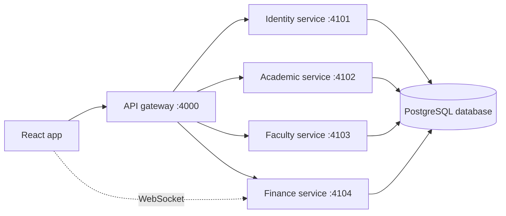

# Backend services and React integration

The React client calls one API gateway. The gateway forwards each feature's request to that feature's own Express server. Each server owns its routes and PostgreSQL schema. The feature servers run as separate Node processes.



The gateway lets the UI keep one `VITE_API_BASE_URL`, while feature services can be developed, started, and deployed separately. PostgreSQL is still one database for now, with feature-owned schemas inside it:

| Feature | PostgreSQL schema | Tables |
| --- | --- | --- |
| Shared student records | `core` | `students` |
| Sign in and accounts | `identity` | `users` |
| Courses and dashboard | `academic` | `courses`, `student_courses`, `student_activities`, `momentum_months`, `student_achievements`, `campus_feed`, `campus_events` |
| Lecturers | `faculty` | `lecturers` |
| Fees and payments | `finance` | `fee_accounts`, `fee_items`, `payments` |

This separates features logically without making you administer a separate database server for each one. The current services share the configured database connection credentials; separate PostgreSQL users and stricter schema permissions can be added when the deployment setup is known.

## What migrations and seeds mean

A **migration** is a numbered SQL change to the database structure. For example, `core/001_students.sql` creates the student schema and table. Later changes should be added as a new file such as `academic/002_add_course_code.sql`, rather than editing a live database by hand. The migration runner records each applied filename in `core.schema_migrations`, so it skips changes that already ran.

A **seed** inserts starter records into tables. These seeds insert sample data based on the mock student, courses, lecturers, and fee items already used by the UI. They run once per filename and are recorded in `core.seed_runs`. Seeds help a new local database show useful data; they are not run on every app visit and are not a substitute for real school records.

To set up a fresh local database, create an empty PostgreSQL database named `edusuite`, then run the migration/seed command below. It creates the feature schemas and sample rows. It does not erase old `public` tables or existing records.

## Run the feature servers

1. Copy `integrations/backend/.env.example` to `integrations/backend/.env` and set `DATABASE_URL` to your PostgreSQL database.
2. Install the backend packages and initialize the database:

   ```sh
   npm --prefix integrations/backend install
   npm run backend:migrate
   ```

3. Start all service processes in development:

   ```sh
   npm run backend:dev
   ```

   The gateway runs on port 4000, then identity on 4101, academic on 4102, faculty on 4103, and finance on 4104. `GET http://localhost:4000/api/v1/health` reports which feature services and database connections are available.

4. To switch the React screens from the current mock data to the API, copy root `.env.example` to `.env`, set `VITE_DATA_SOURCE=api`, and start the frontend with `npm run dev`. Restart Vite after changing environment variables. The finance WebSocket connects directly to port 4104.

## Folder map

- `src/integrations/http`: shared browser fetch client and normalized errors.
- `src/integrations/api`: browser functions for each REST domain.
- `src/integrations/mocks`: mock adapters used while `VITE_DATA_SOURCE=mock`.
- `src/integrations/realtime`: browser WebSocket connection and reconnect behavior.
- `src/hooks/useIntegrationResource.js`: shared mock/API selection and loading/error state.
- `integrations/backend/src/features/<feature>`: feature-owned Express app, routes, and server entrypoint.
- `integrations/backend/src/gateway.js`: one frontend-facing API address and service routing.
- `integrations/backend/src/config` and `src/shared`: database connection, errors, health, and shared server startup.
- `integrations/backend/db/migrations/<feature>`: versioned schema changes owned by a feature.
- `integrations/backend/db/seeds/<feature>`: starter data owned by a feature.

To add a backend feature, create its folder under `src/features`, add an app, routes, and server entry, add its schema migration and optional seed, register its port in `config/env.js` and `dev.js`, and map its URL in `gateway.js`. Then add the browser API module and mock adapter, and connect the page through `useIntegrationResource`.

## API routes

| Method | Route | Service | Purpose |
| --- | --- | --- | --- |
| GET | `/api/v1/health` | Gateway | Per-service and database health |
| POST | `/api/v1/auth/login` | Identity | Authentication integration point |
| GET | `/api/v1/dashboard` | Academic | Student summary, stats, courses, momentum, achievements, campus feed, activity, events |
| GET | `/api/v1/courses` | Academic | Active course list |
| GET | `/api/v1/lecturers` | Faculty | Lecturer summary and directory |
| GET | `/api/v1/finance/overview` | Finance | Fee account, breakdown, receipts, upcoming items |
| POST | `/api/v1/payments` | Finance | Creates a pending payment record |
| WS | `ws://localhost:4104/ws` | Finance | Realtime payment events |

REST responses use `{ "data": ... }`; errors use `{ "error": { "code", "message" } }`. The React HTTP client unwraps `data`, includes a saved bearer token if present, and turns API failures into readable errors.

## Items to finish before real school use

- Authentication deliberately returns `501 AUTH_NOT_CONFIGURED`. Implement password hashing/verification, rate limits, signed expiring tokens, and authorization checks before enabling real accounts. Do not reuse the mock demo password.
- A payment request is saved as `pending`; it does not charge a card or mobile-money account. Connect a payment provider and validate its signed callback before changing a payment to `paid` or changing balances.
- The services currently share database credentials. Give each service a restricted PostgreSQL role before deploying them in a production environment.
